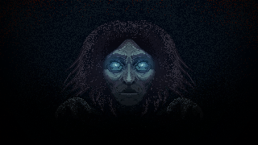
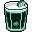

#  A Punta de Machete

*Un survivor top-down 2D ambientado en la fauna y el folclore latinoamericano.*

Te abres paso a punta de machete entre oleadas de mosquitos y animales de la selva, subes de nivel con cartas inspiradas en la fauna local (chigüiro, cóndor, jaguar, rana dorada...) y, cuando la noche se pone pesada, se te aparece **La Llorona**.

Construido en **Unity 6 (URP 2D)** para un game jam.

---

## 🎮 Cómo jugar

- **Muévete** con WASD / stick izquierdo, **apunta** con el mouse / stick derecho.
- **Ataca a machete** para limpiar oleadas enteras de un tajo — conectar varios enemigos en un solo golpe da bonus de experiencia.
- **Sobrevive las rondas**: cada ronda exige una cuota de kills antes de endurecerse (más enemigos, más rápido, más daño).
- **Sube de nivel** y elige cartas de mejora entre especies de la fauna local, cada una con su propio efecto.
- **Llega al jefe**: cuando el campo queda limpio, aparece **La Llorona** con 4 fases, cantos que aturden y hacen daño en área, y una embestida que se vuelve más larga y letal en cada etapa.
- **Gánale y sigue**: tras la victoria se puede entrar en **modo infinito**, donde la dificultad sigue escalando sin techo.

**Controles:** se puede jugar con **teclado + mouse** o con **mando**.

> 📱 En celular se recomienda usar un **mando** conectado: el juego todavía no tiene un HUD táctil, así que sin mando no hay forma de moverte ni atacar en pantalla.

## 🧟 Bestiario

| Enemigo | Rol |
|---|---|
| Zancudo | Rápido y numeroso, te acosa desde el principio |
| Hipopótamo | Tanque que carga y embiste |
| **La Llorona** (jefe) | 4 fases, canto con zonas de aturdimiento, embestida y refuerzos |

## 🃏 Mejoras (cartas)

| Carta | Efecto |
|---|---|
| Chigüiro | Regeneración de vida |
| Colibrí | Ataca más rápido |
| Cóndor | Más rango de ataque |
| Hormiga Arriera | Más radio de recolección |
| Jaguar | +25% de daño |
| Oso de Anteojos | Más vida máxima |
| Rana Dorada | +1 veneno |
| Venado | Más velocidad de movimiento |

Además, el pool de relleno siempre tiene disponible  **Aguapanela** (antes "Hierbas Curativas"): recupera el 25% de la vida máxima.

## 🏆 Puntaje

Se premia, en este orden: llegar rápido al jefe, recibir poco daño, matar al jefe rápido y la agresividad (kills). El resultado (victoria o derrota) se muestra al final con puntaje y tiempo total de la partida.

---

## 🛠️ Stack técnico

- **Unity 6** (`6000.6.0f1`) con **URP 2D**
- **Input System** (teclado/mouse + gamepad)
- Física 2D (`Rigidbody2D`)
- Arquitectura por composición y eventos: componentes pequeños (`Health`, `EnemyChase`, `EnemyContactDamage`...) desacoplados por un bus de eventos (`GameEvents`) y `ScriptableObject`s para datos y mejoras

## 📥 Descargas

| Versión | Plataforma | Enlace |
|---|---|---|
| Android 1.0.0 (última) | APK para celular/tablet | [Descargar](https://github.com/Nicolaspifo/APuntaDeMachete/releases/tag/Android1.0.0) |
| Web 1.0.0 | Navegador (WebGL) | [Descargar](https://github.com/Nicolaspifo/APuntaDeMachete/releases/tag/Web1.0.0) |

Todas las versiones en [Releases](https://github.com/Nicolaspifo/APuntaDeMachete/releases).

