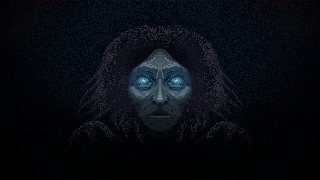

#  A Punta de Machete

*Un survivor top-down 2D ambientado en la fauna y el folclore latinoamericano.*

Te abres paso a punta de machete entre oleadas de mosquitos y animales de la selva, subes de nivel con cartas inspiradas en la fauna local (chigüiro, cóndor, jaguar, rana dorada...) y, cuando la noche se pone pesada, se te aparece **La Llorona**.

Construido en **Unity 6 (URP 2D)** para un game jam.

---

## 🎮 Cómo jugar

- **Muévete** con WASD / stick izquierdo, **apunta** con el mouse / stick derecho.
- **Ataca a machete** para limpiar oleadas enteras de un tajo — conectar varios enemigos en un solo golpe da bonus de experiencia.
- **Sobrevive las rondas**: cada ronda exige una cuota de kills antes de endurecerse (más enemigos, más rápido, más daño).
- **Sube de nivel** y elige cartas de mejora entre especies de la fauna local, cada una con su propio efecto.
- **Llega al jefe**: cuando el campo queda limpio, aparece **La Llorona** con 4 fases, cantos que aturden y hacen daño en área, y una embestida que se vuelve más larga y letal en cada etapa.
- **Completa la meta del nivel** para desbloquear el siguiente y sumar puntos al ranking.

**Controles:** **teclado + mouse**, **mando** o **pantalla táctil**. En celular aparece un joystick virtual para moverse y un botón de pausa; el machete ataca solo.

## 🗺️ Niveles y cuenta

- **10 niveles** que se desbloquean en orden. Cada uno tiene su meta: matar una cantidad de enemigos, sobrevivir un tiempo o vencer a La Llorona (niveles 5 y 10).
- **Terreno procedural:** cada nivel tiene su bioma (río, llanura, pantano, páramo, selva) y el mapa se genera con una semilla distinta en cada intento.
- **Cuenta de jugador:** registro e inicio de sesión con Firebase Authentication. El progreso, los puntajes y los niveles desbloqueados se guardan en Cloud Firestore y se recuperan al volver a entrar.
- **Ranking general** por puntaje total.

Detalles técnicos y configuración de Firebase en [`Documentacion/Backend.md`](Documentacion/Backend.md). Diseño del juego en [`Documentacion/DocumentoDiseno.md`](Documentacion/DocumentoDiseno.md).

## 🧟 Bestiario

| Enemigo | Rol |
|---|---|
| Zancudo | Rápido y numeroso, te acosa desde el principio |
| Hipopótamo | Tanque que carga y embiste |
| **La Llorona** (jefe) | 4 fases, canto con zonas de aturdimiento, embestida y refuerzos |

## 🃏 Mejoras (cartas)

| Carta | Efecto |
|---|---|
| Chigüiro | Regeneración de vida |
| Colibrí | Ataca más rápido |
| Cóndor | Más rango de ataque |
| Hormiga Arriera | Más radio de recolección |
| Jaguar | +25% de daño |
| Oso de Anteojos | Más vida máxima |
| Rana Dorada | +1 veneno |
| Venado | Más velocidad de movimiento |

Además, el pool de relleno siempre tiene disponible  **Aguapanela** (antes "Hierbas Curativas"): recupera el 25% de la vida máxima.

## 🏆 Puntaje

Cada nivel da puntos por enemigos eliminados y, si se gana, bonos por victoria, rapidez y vida restante, con un multiplicador que crece con el nivel. De cada nivel cuenta el mejor intento, y la suma de los diez es el puntaje del ranking.

---

## 🛠️ Stack técnico

- **Unity 6** (`6000.6.0f1`) con **URP 2D**
- **Input System** (teclado/mouse + gamepad)
- Física 2D (`Rigidbody2D`)
- **Firebase** (Authentication + Cloud Firestore) por API REST
- Arquitectura por composición y eventos: componentes pequeños (`Health`, `EnemyChase`, `EnemyContactDamage`...) desacoplados por un bus de eventos (`GameEvents`) y `ScriptableObject`s para datos y mejoras

## 📥 Descargas

| Versión | Plataforma | Enlace |
|---|---|---|
| Android 1.0.0 (última) | APK para celular/tablet | [Descargar](https://github.com/Nicolaspifo/APuntaDeMachete/releases/tag/Android1.0.0) |
| Web 1.0.0 | Navegador (WebGL) | [Descargar](https://github.com/Nicolaspifo/APuntaDeMachete/releases/tag/Web1.0.0) |

Todas las versiones en [Releases](https://github.com/Nicolaspifo/APuntaDeMachete/releases).

